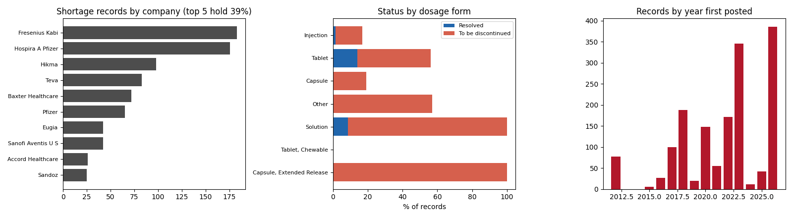

# Who is short, and why? An analysis of the FDA drug shortage list

Drug shortages are a supply chain problem before they are a clinical one. This project looks at the FDA drug shortage list through a supply lens: which companies and dosage forms carry the shortages, how concentrated the supply base is, what reasons are given, and whether the shortage list lines up with manufacturing quality problems (recalls).

## Data

openFDA drug shortages endpoint (https://open.fda.gov/apis/drug/drugshortages/), downloaded 2026-11-26: 1,577 records (one per package NDC), 224 generic drug names, 124 companies after name cleaning. Recall events come from the openFDA drug enforcement endpoint for Jan 2023 to Jun 2025 (the same pull as my openfda-recall-pipeline-duckdb repo). `src/fetch.py` downloads the shortages. The raw JSON is not stored here.

## Findings

- The list is mostly injectables: 991 of 1,577 records (63%). Tablets are 19%, capsules 8%.
- Supply is concentrated. The top 5 companies hold 39% of the records, the top 10 hold 52%. Fresenius Kabi (183 records), Hospira/Pfizer (176), Hikma (98), Teva (83) and Baxter (72) lead. Pfizer appears under two names in the data and I did not merge them, so Pfizer's combined share is larger than shown. The Herfindahl index is 422, which is low overall, but that hides the injectables market where a few firms dominate.
- 69% of the 224 drug names have just one company listed, and the median is 2 records per drug. The list shows who is short, not who else could supply, so I cannot call these single-source drugs.
- Most records have no stated reason: 1,131 of 1,577 (72%). Of the 446 that do, 38% say "Other", 29% say demand increase, 13% a shortage of an active ingredient, 11% discontinuation, 5% shipping delays and 3% good manufacturing practice problems.
- Status mix: 71% of records are "Current", 25% "To be discontinued", and only 59 (3.7%) are "Resolved". Injections are marked resolved in 1.5% of cases, tablets in 13.9%.
- Linking to recalls: for the 40 companies (of 124) that I could match by name to a recalling firm, the rank correlation between shortage records and recall events is 0.30. A permutation test gives p = 0.064, so this is weak evidence, not a finding.
- First-posting years are bumpy: 346 records posted in 2023 and 386 in 2026, with almost nothing posted in 2024. That looks like how the list was updated, not like true waves of shortages.



## Limits

- The shortage list is FDA's list of drugs it has been told are in shortage. It is not a measure of patient access, and a record can sit in "Current" for years. 672 of the 1,116 "Current" records are marked "Available" in their availability field, so "Current" does not mean the product cannot be bought.
- Records are package-level. A company with many presentations of one drug looks bigger than it is.
- Company names are matched by a simple clean-up (punctuation and suffixes removed). Matches to the recall data are partial and some are probably wrong, so the recall link is a rough check.
- I tried a Kaplan-Meier estimate of time to resolution (`data/km_summary.csv`, `data/logrank.csv`), treating "Resolved" records as events and "Current" records as censored. I do not rely on it. With only 59 events whose update dates cluster around a few dates, the curve reflects when FDA edited records more than how long shortages lasted. The log-rank test is huge (injection vs other forms) but I read it as the same status pattern as above, not as durations.
- Therapeutic categories overlap (a drug can have several), so counts there add up to more than the record count.
- openFDA marks this data as unvalidated. It changes daily and these numbers will not reproduce exactly.

## Run it

```
pip install numpy pandas matplotlib
python src/fetch.py
python src/analyze.py
```
`analyze.py` expects the recall records at data/raw_enforcement.jsonl, which is written by `python src/run.py 2023-01 2025-06` in the pipeline repo. Copy it over, or skip the recall section.
